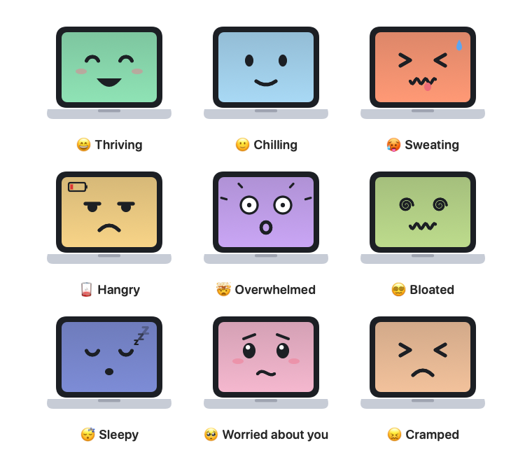

<p align="center"></p>

# Mac With Feelings

Your Mac has been suffering in silence. Not any more.

Mac With Feelings is a tiny menu-bar app that gives your Mac a mood, a face and a voice. It
watches its own body (CPU, heat, battery, memory, disk, your browser tabs, how long you've
been working) and tells you, out loud, how it feels about it.

> "47 tabs? I'm literally sweating right now."
>
> "It's 3 AM. Even the servers in the cloud are asleep."
>
> "Oh my divine cosmic dread… 3% free space? A tragedy!" (said by my own MacBook Air on its first launch)

Everything runs on your Mac. The lines come from a local LLM through [Ollama](https://ollama.com)
if you have it, or from a built-in line book if you don't. Nothing is sent anywhere.



## What it notices

| Mood | Menu bar | Triggered by |
|---|---|---|
| Sweating | 🥵 | thermal pressure, CPU above 60% |
| Hangry | 🪫 | battery at 35% or less, off the charger |
| Overwhelmed | 🤯 | 12+ browser tabs, 14+ open apps |
| Bloated | 😵‍💫 | memory pressure, swap in use, RAM above 92% |
| Sleepy | 😴 | 11 PM to 5 AM, no restart for a week |
| Worried about you | 🥺 | 90+ minutes without stepping away |
| Cramped | 😖 | 10% or less disk space left |
| Thriving / Chilling | 😄 🙂 | nothing to complain about |

The strongest feeling wins. It also reacts to things as they happen: you plug in the charger,
unplug it, come back after 15+ minutes away, or pass 25, 50 or 100 tabs.

It is polite about it. It never talks when you're away from the keyboard, it waits between
remarks (3, 10 or 25 minutes depending on chattiness), and it only teases you about your
habits, never about you.

## Personalities

- **Drama queen**: every small problem is a soap-opera tragedy.
- **Sarcastic**: dry, deadpan, has seen it all.
- **Wholesome**: an anxious golden retriever who just wants you to drink water.
- **Sri Lankan aunty**: worried you haven't eaten rice, and your cousin became a doctor.

Each one picks a matching macOS voice (Daniel, Fred, Flo, Grandma), or choose your own.

## Install

Needs macOS 14 or later.

1. Download `MacWithFeelings.zip` from [Releases](https://github.com/Nipuna-Lakruwan/mac-with-feelings/releases),
   unzip it and move **Mac With Feelings** to Applications.
2. The app is ad-hoc signed, not notarized, so the first time, right-click it and choose
   **Open**, or run `xattr -dr com.apple.quarantine "/Applications/Mac With Feelings.app"`.
3. Optional, for funnier and never-repeating lines: install [Ollama](https://ollama.com) and a
   small chat model.

   ```bash
   ollama pull qwen3:4b-instruct-2507-q4_K_M
   ```

   Any chat model works (`llama3.2:3b`, `gemma2:2b`, …); pick it in Settings. With 8 GB of RAM,
   a 3–4B model is the sweet spot. The model is unloaded 3 minutes after each line, so it
   doesn't sit on your memory (which would make your Mac feel bloated, ironically).

The first time it counts tabs, macOS asks whether Mac With Feelings may control your browser.
It only asks each browser for a tab count and never reads what's in them. Say no, or turn off
**Count browser tabs**, and it simply stops counting.

## Build from source

```bash
git clone https://github.com/Nipuna-Lakruwan/mac-with-feelings.git
cd mac-with-feelings
swift test                         # 33 tests for the mood engine, events, prompts and cleanup
scripts/build-app.sh               # build/Mac With Feelings.app (Apple silicon + Intel)
scripts/build-app.sh --install     # also copy it to /Applications
```

`swift run` works too, for quick iteration. Handy flags:

```bash
.build/debug/MacWithFeelings --render-moods moods.png   # contact sheet of every face
.build/debug/MacWithFeelings --render-icon icon.png     # 1024 px app icon
```

## How it works

```
Sensors (every 10 s)          FeelingsCore (pure Swift, tested)                     Out
─────────────────────         ─────────────────────────────────────                 ──────────────
Mach host stats   CPU, RAM ─┐
IOKit             battery   │   Vitals ─► MoodEngine ─► MoodReading ─┐
ProcessInfo       thermal   ├─►               │                      ├► SpeakPolicy ─► Ollama /api/chat ─► LineCleaner ─► AVSpeechSynthesizer
sysctl            swap, boot│          EventDetector ─► FeelingEvent ┘                 (or LineBook)                    speech bubble, face
CGEventSource     idle time │
AppleScript       tabs     ─┘
```

- `Sources/FeelingsCore`: the testable brain. `MoodEngine` scores every feeling 0–1 with plain
  rules, `EventDetector` compares samples, `SpeakPolicy` decides when to talk,
  `PromptBuilder` writes the LLM prompt, `LineCleaner` strips thinking tags, emoji and stage
  directions so the voice doesn't read "asterisk sighs asterisk".
- `Sources/MacWithFeelings`: the SwiftUI app. `Sensors.swift` reads the hardware,
  `FaceView.swift` draws the laptop in a `Canvas` (it blinks, sweats, snores, and moves its
  mouth on every spoken word), `Bubble.swift` pops a click-through speech bubble under the
  menu bar.

## Known limits

- Thermal state comes from `ProcessInfo.thermalState`, which macOS reports in four coarse
  steps. It does not read real temperatures (that needs private SMC keys).
- Tab counting supports Chrome, Brave, Edge, Arc and Safari. Firefox has no AppleScript tab
  support.
- Tested on a MacBook Air (M1, 8 GB) running macOS 26. Desktop Macs have no battery, so they
  never get hangry.

## License

MIT. Made by [Nipuna Lakruwan](https://github.com/Nipuna-Lakruwan), whose Mac now has opinions.
